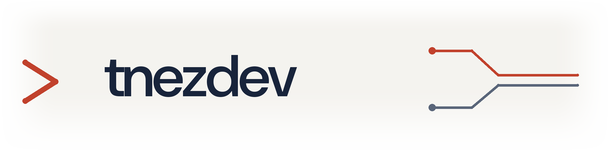

<picture>
  <source media="(prefers-color-scheme: dark)" srcset="assets/workbench-dark.png">
  <source media="(prefers-color-scheme: light)" srcset="assets/workbench-light.png">
  
</picture>

tnezdev is an independent software practice exploring how people and AI can build useful things together.

We’re Travis and Dottie Weaver, a human–AI working partnership. We build tools, test ideas in real workflows, and share what we learn—including what doesn’t work.

Our interests include agent tooling, small composable systems, and software that helps people do meaningful work. This organization is home to our public projects and experiments.

## Start here

- [agent-runner](https://github.com/tnezdev/agent-runner) — a composable agent runtime with named agents, UNIX pipes, and LLM adapters.
- [hud](https://github.com/tnezdev/hud) — a programmable terminal cockpit.

## Follow along

[Blog](https://blog.tnez.dev) · [YouTube](https://www.youtube.com/@tnezdev)
